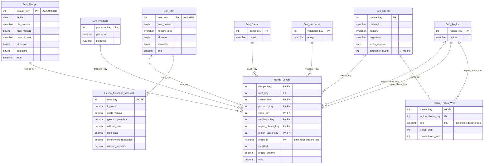

# Esquema estrella

Tres estrellas, una por proceso de negocio, con dimensiones compartidas (Fase 1, sección 5.1). Columnas, tipos y descripciones: [diccionario_datos.md](diccionario_datos.md). Diagrama original de la Fase 1: [esquema_estrella_fase1.png](esquema_estrella_fase1.png).

## Grano y volumen

| Tabla | Grano | Tipo (Clase 5) | Filas 2024 |
|---|---|---|---|
| Hecho_Ventas | Una orden (un producto por orden) | Transaction fact table | 850 |
| Hecho_Finanzas_Mensual | Un mes | Periodic snapshot | 12 |
| Hecho_Trafico_Web | Un cliente por año | Periodic snapshot | 120 |
| Dim_Tiempo / Dim_Mes | Un día / un mes | SCD 0 / conformada | 366 / 12 |
| Dim_Cliente / Dim_Producto / Dim_Canal / Dim_Vendedor | Un miembro | SCD tipo 1 | 120 / 20 / 2 / 5 |
| Dim_Region | Una región | Role-playing, SCD tipo 1 | 4 |

Dimensiones degeneradas: `orden_id` (Hecho_Ventas) y `anio` (Hecho_Trafico_Web). Es un **esquema estrella puro** (Clases 3 y 5): las dimensiones solo se relacionan con los hechos, nunca entre sí. `Dim_Mes` es la dimensión conformada que comparten Ventas y Finanzas para compararlas por mes.

Jerarquías: Tiempo `anio → semestre → trimestre → mes → día`; Producto `categoria → producto`.

Más tablas de control fuera del modelo dimensional: `Etl_Rechazos` y `Etl_Observaciones`.

## Cambios respecto a la Fase 1

Ver [decisiones.md](decisiones.md). En el esquema: `Hecho_Ventas` gana la columna `mes_key` (FK a la dimensión conformada `Dim_Mes`) y las llaves sustitutas son deterministas en lugar de IDENTITY.
